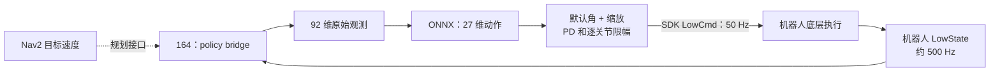

# 机器人运控策略更改

> 这次改变的是速度指令之后的运动执行：原来把目标速度交给宇树原运控，新方案由独立策略进程计算 27 个关节的控制命令。原定位、感知与 Nav2 规划链路保持；当前已有真机只读、shadow 和准备阶段命令记录，但物理控制权及关节响应尚未确认，ONNX 从未驱动实机关节。

## 原架构：速度交给原运控


164 上项目负责导航、速度平滑与转发；`SetVelocity` 只给机器人目标速度，速度之后的运动生成由原运控链路负责，内部算法及底层关节控制分工未知。161 内部不可访问，底层具体承载板未知，不能把它当作本项目已实现的代码。

## 新架构：速度交给策略执行器



这是替换速度之后运动生成的目标链路：原方案经高层接口将速度交给 161 原运控；新方案计划由 164 的自建进程计算低层命令。161 没有被删除，机器人底层仍负责执行；也不能说把 161 的黑盒算法搬了出来。**真机 hardware 配置当前强制零速度**，主导航 launch 的 policy 接入仅限仿真，因此图中导航到真机策略的虚线尚未联通。

每个 50 Hz 控制周期，桥从 LowState 读取机体角速度、重力投影、27 关节位置和速度，连同速度、相位及上一动作组成 92 维原始观测；ONNX 输出 27 维 action。归一化已在 ONNX 内部，外部不重复归一化。目标角 `q_target = default + scale × action`，再计算 `kp × (q_target - q) - kd × dq` 并逐关节限幅，写入 SDK HG LowCmd 的力矩字段，策略阶段消息中 kp/kd 为零；真机 Passive 采用电机侧阻尼。真机 SDK DDS 走 `eth0`、domain 0；本次验收的 ROS 隔离会话使用 domain 43 和 localhost，二者不是同一个 domain。状态约 500 Hz，命令 50 Hz。

27 关节映射中，部署说明的腕关节顺序为 pitch、roll，SDK 为 roll、pitch，因此双腕对应位置交换；SDK 顺序有依据，但模型训练和实机的关节语义仍须验证。实现见 [观测与 PD](/home/llx/h1_nav2_ros2_ws/src/h1_2_policy_bridge/src/core.cpp) 和 [硬件适配](/home/llx/h1_nav2_ros2_ws/docs/h1_2-policy-hardware-adaptation.md)。

## 职责与运行方式对比

| 项目 | 原 `unitree` 后端 | 新 `policy` 后端 |
| --- | --- | --- |
| 下游接口 | 高层目标速度，原运控生成关节运动 | 策略进程读关节状态、发送低层关节命令 |
| 运动生成与控制逻辑 | 原运控黑盒，是否使用学习策略及关节控制分工未知 | 策略执行器组装观测、运行 ONNX、显式计算限幅 PD 力矩并管理准备及接管状态 |
| 启动与控制权 | 原 loco bridge 和 daemon | 独立策略进程；人工依次准备 Passive → FixStand → ArmHoldStand → ArmHold 后执行策略；真机导航尚未接入 |

主导航通过 `motion_backend=unitree|policy` 互斥选择，默认 `unitree`；策略模式不启动旧 loco bridge/daemon。策略独占 27 关节，保持右臂胸前 ArmHold 姿态，冲突手势暂停。两者不能同时作为关节控制者；当前软件互斥并不证明实机控制权仲裁已经解决，hardware 固定零速度。

沿用导航参数：Nav2 前进 `0～0.20 m/s`、横向 `0`、最大 yaw `0.50 rad/s`；桥接限制 `vx ±0.20 m/s`、`vy 0`、`wz ±0.50 rad/s`。速度输入超过 `0.4 s` 未更新则归零，策略继续站立；底层故障另行处理。软件停止发布命令不等于实机已经安全停机。

## 状态机前后变化

原实际系统中，操作习惯是先用遥控器准备机器人，再启动导航；164 的旧 bridge/daemon 负责速度转发及 `Start/StopMove` 等高层调用，161 原运控内部状态机不可见。主导航配置中的自动启动选项与人工准备习惯是两回事，不能据此推断原厂内部有同名状态或采用何种控制算法。

| 对比      | 原实际系统                    | 当前策略进程                                                                            |
| ------- | ------------------------ | --------------------------------------------------------------------------------- |
| 状态与控制位置 | 161 原运控内部不可见；项目不管理其关节状态机 | 独立 Controller 管理 `Passive`、`FixStand`、`ArmHoldStand`、`ArmHold`、`Fault`，不跟随 161 状态 |
| 操作入口    | 人工遥控准备，再导航               | ROS Trigger 服务依次人工调用；尚未绑定遥控按钮。导航启动不会自动进入策略，节点存在也不等于策略正在执行                         |
| 执行与故障   | 高层速度交给原运控，内部故障语义未知       | 准备阶段用插值 PD；仅 `ArmHold` 执行策略。底层状态异常或推理、发送故障停发，须人工恢复                                |

`ArmHoldStand/ArmHold` 的命名和准备流程来自用户提供的 ArmHold 部署说明；现在由新包实现并增加 `Fault`，并未修改参考仓库，也不是嵌入 161 原状态机。操作顺序仍是人工准备后导航，但入口变为 `/h1_2_policy_node/` 下的 `passive`、`fix_stand`、`arm_hold_stand`、`arm_hold` 服务。正式真机还需连接遥控器或操作面板，并解决控制权仲裁。

当前初始模式虽为 `Passive`，但 `active=false`，不发命令。仿真收到有效新鲜状态后，人工调用 `passive` 才开始阻尼；真机还须先显式授权，授权成功即开始 Passive 阻尼；随后人工调用 `fix_stand`，至少 3 秒后可调用 `arm_hold_stand`，再过至少 3 秒且双膝各满足距 0.9 rad 小于 0.07 rad、重力投影 z < -0.9 才能调用 `arm_hold`。进入时上一动作清零，步态相位在准备期间持续推进。这些条件不能证明机身高度、吊带或真机已准备好。

节点每 20 ms 检查控制：`LowState` 须在 100 ms 内更新且输入有效；仿真 `mode_machine=0`、真机 `mode_machine=6`，两者均要求 `mode_pr=0`；速度超过 400 ms 未更新则归零，并不进入故障。底层状态异常、非有限输入、推理或发送故障进入 `Fault` 并令 `active=false` 停发；状态恢复有效后，仿真须人工调用 `passive`；真机还须重新授权，不能自动恢复输出。`ArmHold` 才将 92 维观测送入 ONNX 得到 27 维动作，经 PD 和力矩限幅后写入 `LowCmd`（消息的 kp/kd 为 0）。真机已有状态接收、shadow 和准备阶段命令记录，但尚未确认实际控制权或运动。实现见 [控制器](/home/llx/h1_nav2_ros2_ws/src/h1_2_policy_bridge/src/controller.cpp) 和 [节点](/home/llx/h1_nav2_ros2_ws/src/h1_2_policy_bridge/include/h1_2_policy_bridge/node.hpp)。

另一个可见的“之前”是参考项目 `unitree_rl_mjlab` 的 H1_2 FSM：初始 `Passive`，`LT+上` 到 `FixStand`，`RT+A` 到 `Velocity`，`LT+B` 返回 `Passive`；进入 `Velocity` 才启动策略线程。这是参考实现，不能视为 161 原厂状态机。见 [参考配置](/home/llx/unitree_rl_mjlab/deploy/robots/h1_2/config/config.yaml)、[初始状态](/home/llx/unitree_rl_mjlab/deploy/include/FSM/CtrlFSM.h) 和 [策略线程](/home/llx/unitree_rl_mjlab/deploy/include/FSM/State_RLBase.h)。

## 对照项目结构看调用链

下面的路径相对于开发机工作区 `/home/llx/h1_nav2_ros2_ws`；只列与这次替换直接有关的文件：

```text
src/
├── h1_2_slam_bringup/launch/h1_2_nav2_navigation.launch.py
├── h1_2_nav_tools/h1_2_nav_tools/velocity_smoother_ema.py
├── h1_2_loco_bridge/
│   ├── launch/h1_2_loco_bridge.launch.py
│   └── src/{cmd_vel_to_h1_2_loco.cpp,h1_2_loco_udp_daemon.cpp}
└── h1_2_policy_bridge/
    ├── launch/policy_bridge.launch.py
    ├── include/h1_2_policy_bridge/{node.hpp,core.hpp,io.hpp,hardware.hpp}
    ├── src/{main.cpp,node.cpp,controller.cpp,core.cpp,ort.cpp,io.cpp}
    └── README.md
tools/h1_2_policy_hardware/run_acceptance.py
tools/h1_2_policy_sim/README.md
docs/h1_2-policy-hardware-adaptation.md
```

| 文件 | 在链路中的职责 |
| --- | --- |
| `h1_2_nav2_navigation.launch.py` | 启动导航和平滑器，按 `motion_backend` 选择旧桥或策略桥；默认 `unitree`。 |
| `velocity_smoother_ema.py` | 平滑导航速度，主 launch 配置输出 `/cmd_vel_final`。 |
| `h1_2_loco_bridge.launch.py`、`cmd_vel_to_h1_2_loco.cpp`、`h1_2_loco_udp_daemon.cpp` | 旧 launch 启动桥和 daemon；桥接收速度并发本机 UDP，daemon 接收后调用 `LocoClient.SetVelocity`，也处理 `Start/StopMove`。 |
| `policy_bridge.launch.py`、`main.cpp` | 前者配置策略节点参数；后者初始化 ROS、创建 SDK IO 和 `PolicyNode` 并 spin。 |
| `include/.../node.hpp`、`src/node.cpp` | 主要节点实现在头文件：订阅、服务、20 ms 定时器、状态检查、授权和 LowCmd 发送门禁；`node.cpp` 只是包含该头文件。 |
| `controller.cpp` | 管理人工状态转换、准备姿态插值和策略阶段调用顺序。 |
| `core.cpp`、`ort.cpp` | 前者做观测、关节顺序映射和限幅 PD；后者加载 ONNX Runtime 会话、检查输入输出并推理。 |
| `io.cpp`、`io.hpp`、`hardware.hpp` | IO 封装 SDK DDS 状态订阅和命令发布；硬件辅助代码负责状态、CRC、授权等检查。 |
| `run_acceptance.py`、仿真 README、硬件适配文档 | 分别给出现场验收工具、仿真方式和板端构建部署说明；它们不是策略推理本体。 |

沿文件追踪，旧链是 `h1_2_nav2_navigation.launch.py → velocity_smoother_ema.py → h1_2_loco_bridge.launch.py → cmd_vel_to_h1_2_loco.cpp → localhost UDP → h1_2_loco_udp_daemon.cpp → SetVelocity`。新链在同一平滑器之后改为 `policy_bridge.launch.py → main.cpp → node.hpp → controller.cpp → core.cpp / ort.cpp → node.hpp → io.cpp → SDK LowCmd`；机器人状态则由 `io.cpp` 订阅 `rt/lowstate` 回到节点。`rt/lowcmd` 是 SDK DDS 通道，和 ROS 的速度话题及服务不是同一接口。

主导航的 `motion_backend:=policy` 当前只允许 `policy_network_interface:=lo`、`policy_dds_domain:=42`，且手势路线必须为空；因此它只接仿真。独立策略入口 `ros2 launch h1_2_policy_bridge policy_bridge.launch.py` 默认 `profile:=sim`、`network_interface:=lo`、`dds_domain:=42`、`model_path:=/home/llx/policy.onnx`。164 真机只读入口需显式选 `profile:=hardware network_interface:=eth0 dds_domain:=0` 和板端模型路径；硬件输出及两项人工确认默认 false，`max_policy_steps` 默认 0。节点私有 Trigger 服务解析到 `/h1_2_policy_node/`，包括 `status`、`passive`、`fix_stand`、`arm_hold_stand`、`arm_hold`；hardware 还提供 `shadow`、`authorize_output`、`revoke_output`。启动节点本身不等于进入策略或取得控制权。

开发机默认模型是 `/home/llx/policy.onnx`；164 的部署模型路径为 `/home/unitree/h1_nav2_ros2_ws/models/h1_2_armhold/policy.onnx`，ONNX Runtime 和 Unitree SDK 依赖分别落在该工作区 `third_party/h1_policy_runtime/onnxruntime` 与 `third_party/h1_policy_runtime/unitree_sdk2`。板端构建示例和版本限制见 [硬件适配文档](/home/llx/h1_nav2_ros2_ws/docs/h1_2-policy-hardware-adaptation.md)。

## 一次控制循环怎么走

1. `io.cpp` 从 SDK `rt/lowstate` 接收状态；`node.hpp` 缓存并检查新鲜度、模式和有效性，hardware 还检查 CRC 与 tick。`read()` 将 SDK 顺序转换成策略顺序，并由姿态计算重力投影。
2. 节点每 20 ms 的 `tick()` 在未激活时返回；激活后读取状态并处理速度。仿真使用速度话题，超时归零并限幅；**hardware 无条件使用零速度**，因此即使订阅了 `/cmd_vel_final`，真机导航指令也没有接入策略运动。
3. 准备阶段调用 `Controller::step()`：推进相位，Passive 采用阻尼；FixStand 和 ArmHoldStand 根据进入状态时的关节位置，用三秒插值到各自目标并计算限幅 PD。此阶段不调用 ONNX。hardware Passive 特别使用电机侧阻尼：`tau=0`、`kp=0`、`kd` 为阻尼值。
4. 只有进入 ArmHold 后，`Controller::step()` 才依次调用 `core_.observe()`、`policy_.infer()`、`core_.torque()`、`core_.set_last_action()`；其中 `OrtPolicy::infer()` 将 92 维观测送入 ONNX Runtime，得到 27 维动作，供 PD 计算。
5. 节点把力矩转回 SDK 顺序，构造 LowCmd、计算 CRC，再经授权及状态复查后调用 `io_->write()`。策略和站立准备的 PD 力矩写入 `tau`，对应消息 `kp/kd` 为零；shadow 则只推理和记录，不创建 LowCmd publisher。异常进入 Fault 并停发，停发本身不能证明物理安全。

## 真机准备与受限策略入口

hardware 启动默认只读，不创建 LowCmd publisher；`enable_hardware_output`、`operator_confirmed_debug_mode`、`operator_confirmed_exclusive_control` 均默认为 `false`，`max_policy_steps=0`。确认标志仅记录人工确认，不能证明固件控制权。节点不会自动调用 `ReleaseMode`；原运控的释放和恢复须按现场正式流程确认，不能从消息模式推断已释放。授权后从 Passive 阻尼开始，按 `Passive → FixStand（至少 3 秒）→ ArmHoldStand（至少 3 秒）→ ArmHold` 人工推进。进入 ArmHold 还需双膝分别距 0.9 rad 小于 0.07 rad、重力投影 z < -0.9；吊装高度、支撑和周围环境仍需人工目视确认。故障会撤销授权并停发，不会自动重新授权；停发后的实际电机行为不能由软件保证。

[验收脚本](/home/llx/h1_nav2_ros2_ws/tools/h1_2_policy_hardware/run_acceptance.py) 默认 dry-run、零策略预算，显式 `--execute` 才运行准备阶段；`--source-commit` 是操作者填写的部署来源，不是自动证明。执行准备前须确认吊装约 60%、急停人员就位、空间无阻挡，并确认官方调试与独占控制流程。约 0.95 m 站高和双腿直立是 ArmHoldStand 落稳后、策略接管前的现场目视条件。脚本检查状态、命令和 CRC，执行准备并最终回 Passive、撤权、确认停发。它额外监视关节速度 2 rad/s，这是验收保护，不是模型或原部署说明的门槛；此前额外的全关节 0.35 rad 关节误差门槛已从新脚本移除。

若将来经过现场审查需要受限策略试验，脚本允许显式配置 1～5 帧正预算，并要求启用现场确认：ArmHoldStand 稳定后现场输入 `CONFIRM`，节点还检查膝角与直立条件。预算耗尽回 Passive，并以日志验证耗尽；帧数不能保证实时持续时间或实际电机响应。**正预算尚未实测**，准备阶段发出命令也不等于 ONNX 已控制关节。

## 实际案例：2026-11-02 真机准备

现场确认吊装约 60%、急停人员就位、阻尼调试及右臂无阻挡后，运行当时的 `run_acceptance_20261102.py --execute`，策略预算为 0。FixStand 观察 3.1056 秒，节点写入与接收均为 155 帧；进入 ArmHoldStand 约 0.06 秒后，SDK 19 左腕 yaw 遥测 `dq=-2.13684 rad/s` 触发验收脚本的 2 rad/s 保护，随后回 Passive 并撤权。累计 191 帧 LowCmd、CRC 错误 0；节点退出码 0、监测进程 SIGINT 退出码 -2，无残留，Web 仍 active。现场反馈没有明显动作，实际控制权未确认。该结果不能称实机控制跑通；ONNX 已完成静态数值回归和真机只读 shadow 推理，从未驱动实机关节。

记录位于机器人 `/home/unitree/h1_nav2_ros2_ws/third_party/h1_policy_runtime/integration-record/acceptance-20261102T115729`。当前工作区 HEAD `eac4a99` 是后续验收脚本提交，节点二进制部署来源为 `1c9b8cc`；两者不应混为同一版本。

## 实际案例：隔离闭环能说明什么

2026-10-30 的静态 ONNX Runtime 回归最大绝对差为 `0.000457704`，容差 `0.01`，只验证数值输出，不能证明物理关节语义。真实 ROS 节点经本机 DDS 接入 MuJoCo，零速度、前进和转向各自由物理运行至少 30 秒，均未跌倒。前进指令 `0.2 m/s` 时平均机体系 `vx=0.1541`、`vy=-0.0386 m/s`；转向指令 `0.5 rad/s` 时平均 `wz=0.4468 rad/s`，表明存在跟踪偏差。

准备阶段使用理想固定基座，接管后才释放；这不代表真实吊带或人工准备。仅施加 60% 自重竖直力的准备实验失败。零速度时左足最长无接触 16 ms，严格“不迈步”尚无判定，不能称全部验收通过。真实腕序、161 控制权释放与恢复、164 实时性和实机行为均未验证。

## 下一步与资料

最小验证行动：为腕关节训练顺序补充可追溯证据，并据此核对部署说明与逐关节对应表；继续厘清控制权及实机响应，再考虑受限策略试验。目前只有 ONNX 和部署说明，原训练代码不可用；静态向量和稳定仿真都不能代替这项语义核对。合上笔记后用 60 秒复述：速度接口之后的控制责任移到了哪里，当前证据证明了什么，接下来先核对什么。

- 相关笔记：[[05 宇树机器人新架构登录]]、[[01 宇树机器人重要指令]]。
- [第一阶段规格与验收](/home/llx/h1_nav2_ros2_ws/docs/h1_2-policy-phase1.md)、[策略桥说明](/home/llx/h1_nav2_ros2_ws/src/h1_2_policy_bridge/README.md)、[仿真说明](/home/llx/h1_nav2_ros2_ws/tools/h1_2_policy_sim/README.md)。
- 持久结果：[零速度](/home/llx/h1_nav2_ros2_ws/tools/h1_2_policy_sim/results/dds_zero.json)、[前进](/home/llx/h1_nav2_ros2_ws/tools/h1_2_policy_sim/results/dds_forward.json)、[转向](/home/llx/h1_nav2_ros2_ws/tools/h1_2_policy_sim/results/dds_turn.json)。
